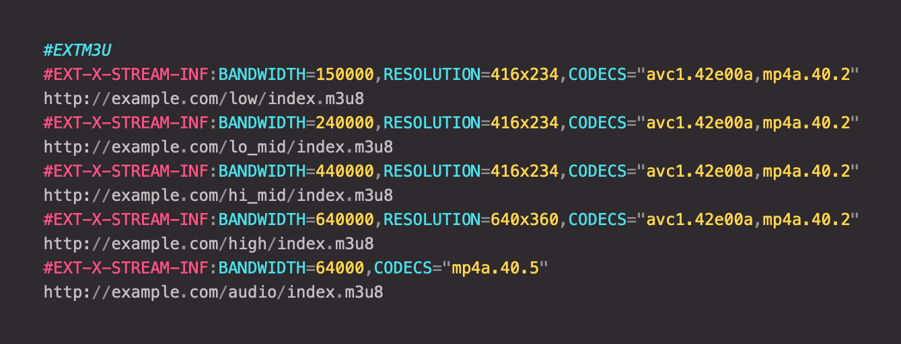

# prism-language-m3u

M3U language definition for syntax highlighting of [M3U and Extended M3U playlists](https://en.wikipedia.org/wiki/M3U) with [Prism](https://prismjs.com), including HLS and IPTV.

It highlights the same way as [tree-sitter-m3u](https://github.com/mlinder/tree-sitter-m3u), and the tests compare the two character by character. Tags and attribute names that the specifications don't define stay plain, so typos such as `BANDWDTH` stand out.

## Screenshot



## Usage

Load the language definition after Prism and define additional classes in your stylesheet if needed.

Usage with a bundler:

```console
npm install prism-language-m3u
```

```js
import Prism from "prismjs";
import "prism-language-m3u";
```

Or the classic way:

```html
<script src="prism.js"></script>
<script src="prism-m3u.js"></script>
```

Sample markup (`language-m3u8` works too):

```html
<pre><code class="language-m3u">#EXTM3U
#EXT-X-STREAM-INF:BANDWIDTH=150000,RESOLUTION=416x234,CODECS="avc1.42e00a,mp4a.40.2"
http://example.com/low/index.m3u8
#EXT-X-STREAM-INF:BANDWIDTH=240000,RESOLUTION=416x234,CODECS="avc1.42e00a,mp4a.40.2"
http://example.com/lo_mid/index.m3u8
#EXT-X-STREAM-INF:BANDWIDTH=440000,RESOLUTION=416x234,CODECS="avc1.42e00a,mp4a.40.2"
http://example.com/hi_mid/index.m3u8
#EXT-X-STREAM-INF:BANDWIDTH=640000,RESOLUTION=640x360,CODECS="avc1.42e00a,mp4a.40.2"
http://example.com/high/index.m3u8
#EXT-X-STREAM-INF:BANDWIDTH=64000,CODECS="mp4a.40.5"
http://example.com/audio/index.m3u8
</code></pre>
```

## Tokens

Useful if you want to style M3U differently from other languages.

| Token | Alias | Highlights |
| --- | --- | --- |
| `doctype` | | `#EXTM3U` |
| `tag` | | Known tag names |
| `attr-name` | | Known, `X-` and lowercase (IPTV) attribute names |
| `operator` | | `=` |
| `attr-value` | `string` | Quoted attribute values |
| `string` | | Other attribute values |
| `number`, `duration` | `number` | Numbers, resolutions, byte ranges, `#EXTINF` durations |
| `constant` | | Enumerated values: `AUDIO`, `YES`, `AES-128` |
| `boolean` | | `true`, `false` |
| `date` | `string` | `#EXT-X-PROGRAM-DATE-TIME` values |
| `title` | `string` | `#EXTINF` titles |
| `punctuation` | | `,` and the `@` of byte ranges |
| `comment` | | Comments |
| `uri` | `url` | URIs |
| `variable` | | `{$variable}` |
| `escape` | `entity` | `%20` |

The other tokens (`header`, `extinf`, `directive`, `value`, `attribute`, `byte-range` and `quoted-string`) just group the ones above.

## Development

```console
npm install
npm test
```

The tests run every playlist in `test/samples` through both Prism and tree-sitter-m3u and fail on any difference. One difference is on purpose: Prism also highlights IPTV attributes on the `#EXTM3U` line.

- Check your own playlists without committing them: `EXTRA_SAMPLES=dir1:dir2 npm test`.
- Write the samples as PrismJS test files: `npm run export-prism-tests -- <dir>`. Useful if this ever goes into Prism itself.
